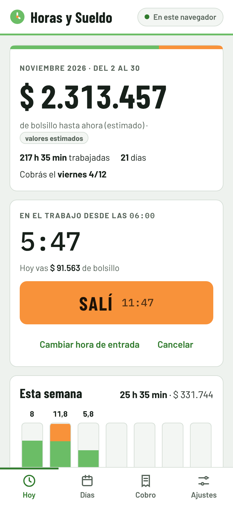
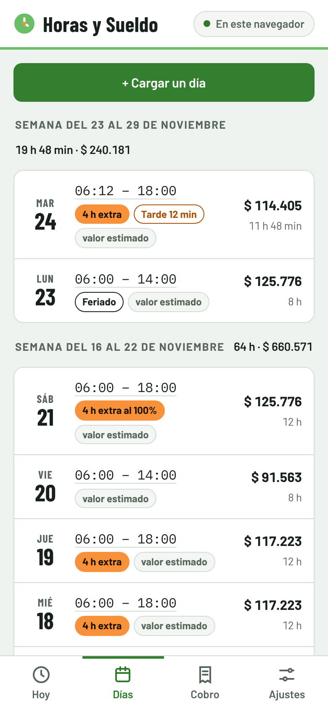
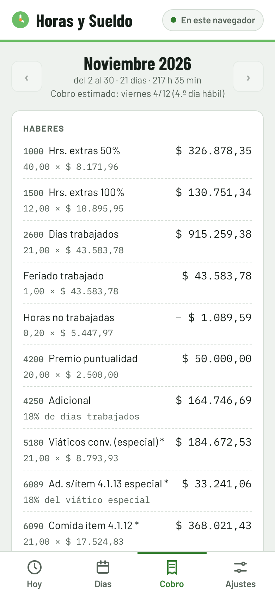
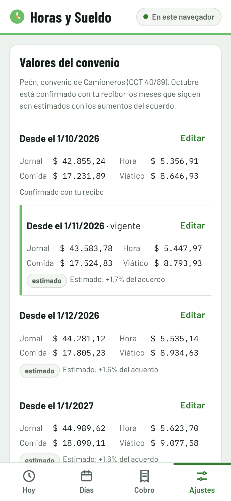

# Horas y Sueldo


App web para fichar la entrada y la salida del trabajo y saber cuánto vas cobrando en el mes. Está pensada para peones del convenio de Camioneros (CCT 40/89) y calcula el sueldo con las mismas líneas y códigos que el recibo.

**Probala:** https://lauta1801.github.io/sueldo-hora/

| Hoy | Días | Cobro | Ajustes |
|---|---|---|---|
|  |  |  |  |

## Qué hace

- **Fichar con un botón:** «Entré» y «Salí», o cargar los días a mano.
- **Lo que llevás cobrado:** jornal, horas extra al 50 % y al 100 %, adicional, premios, comida y viático especial, menos los descuentos.
- **Recibo estimado:** las mismas líneas y códigos que el recibo real, para compararlos.
- **Avisos:** llegadas tarde, horas que faltaron, feriados y descansos de menos de 12 horas entre jornadas.
- **Respaldo:** copias en un archivo y exportación para Excel.
- **Sin internet:** se instala en el celular como una app y funciona sin conexión. Los datos quedan solo en el navegador; no hay servidor ni cuentas.

## Cómo está hecha

HTML, CSS y JavaScript con módulos del navegador, sin frameworks ni paso de compilación. El cálculo está separado de la interfaz: son funciones puras que reciben los datos y devuelven los montos, así que se pueden probar sin abrir la página.

```
index.html               estructura de la página
css/estilos.css          estilos
js/
  main.js                punto de entrada
  app.js                 navegación, eventos y reloj
  calculo.js             cálculo del sueldo (funciones puras)
  convenio.js            escalas del convenio, aumentos y feriados
  periodos.js            períodos de cobro y fecha de pago
  ajustes.js             valores por defecto y migraciones de los ajustes
  datos.js               validación de los datos y unión de copias
  estado.js              datos en memoria y guardado
  almacenamiento.js      lectura y escritura en el navegador (localStorage)
  copias.js              copias de respaldo y exportación a CSV
  interfaz.js            avisos, diálogos y descargas
  utilidades.js          fechas, horas y formato de números
  pantallas/             hoy, días, cobro, ajustes y el editor de un día
sw.js                    service worker para usarla sin internet
tests/                   pruebas automáticas
```

## Pruebas

```
npm test
```

Usa el runner de pruebas que trae Node (versión 20 o más nueva), así que no hay que instalar nada. Las pruebas cubren las reglas de las horas extra, las llegadas tarde, los feriados, los períodos de cobro y las migraciones de datos. La principal reproduce al centavo un recibo de sueldo real de octubre de 2026.

GitHub Actions corre las pruebas cada vez que se sube un cambio.

## Correrla en tu computadora

Los módulos de JavaScript no funcionan abriendo el archivo directamente, así que hace falta un servidor local. Desde la carpeta del proyecto:

```
python -m http.server 8000
```

Después abrí http://localhost:8000 en el navegador.

## Aviso

Es un proyecto personal y no es una app oficial de ninguna empresa. Los montos son estimaciones; lo que vale es el recibo de sueldo.

---

Hecho por Lautaro Perez, estudiante de Ingeniería en Sistemas de Información (UTN).
